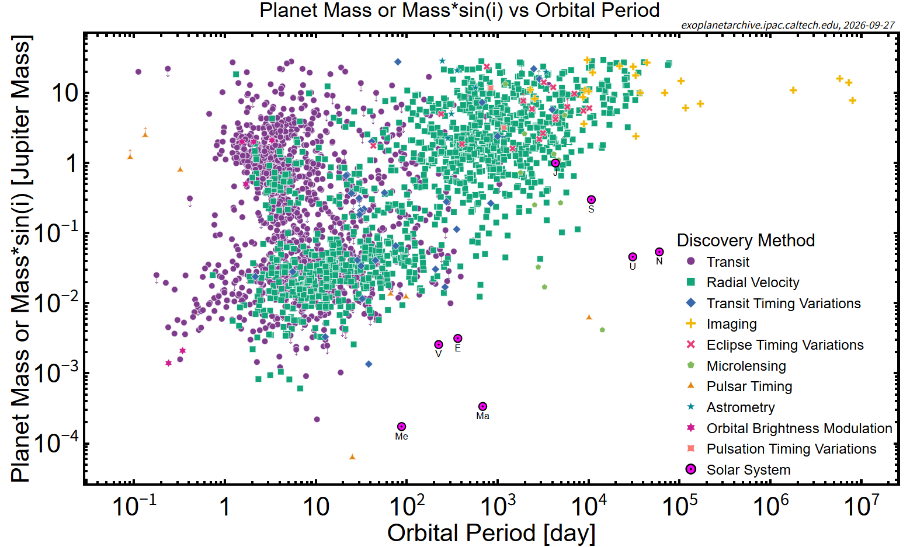
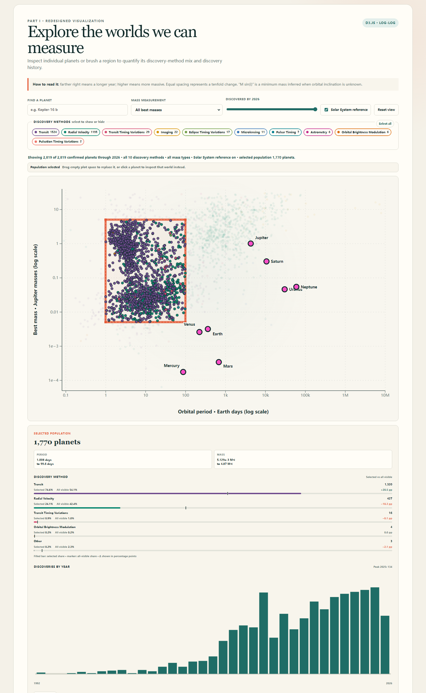

# Visualization Critique and Redesign Report

## NASA Exoplanet Mass–Period Space

### Original visualization and context

NASA's "Planet Mass or Mass*sin(i) vs Orbital Period" scatterplot summarizes confirmed exoplanets with both quantities available. Horizontal position shows orbital period in days; vertical position shows best mass in Jupiter masses. Both axes are logarithmic. Color and shape identify discovery method, while eight outlined points locate the Solar System planets. The intended message is that known planets occupy an enormous and structured parameter space, and that detection methods populate different regions of it.

The audience includes astronomers, students, science communicators, and curious members of the public. They should be able to locate clusters and outliers, compare discovery methods, judge orders of magnitude, and relate unfamiliar worlds to Earth, Jupiter, and their neighbors. The chart is therefore both a scientific overview and presentation material rather than a tool for estimating planet occurrence rates.

### Critique

Two choices work especially well. First, position on aligned axes is an accurate channel for comparing quantitative values, and logarithmic scales make ranges from hours to millennia and sub-Earth to super-Jupiter masses visible together. Second, encoding discovery method and adding Solar System anchors gives the distribution scientific context: the dense short-period Transit region differs visibly from the Radial Velocity population, while familiar planets establish a useful frame of reference.

Three problems limit those strengths. The largest is overplotting. More than 2,700 Transit and Radial Velocity planets use opaque marks, hiding local density and covering rarer methods. The oversized eleven-item legend then occupies the lower-right data region and requires repeated lookup between symbols and labels. Color and shape together distinguish many categories, but several tiny symbols remain difficult to decode and compare.

The chart also asks non-specialists to interpret "Mass or Mass*sin(i)" without explaining that M sin(i) is a lower bound caused by unknown inclination. Abbreviated Solar System labels such as "Me" and "Ma" slow identification. Finally, the static image cannot identify a planet, expose uncertainty, isolate a method, or reveal how discoveries accumulated over time. These are task failures rather than merely stylistic objections: overlap obstructs comparison, technical ambiguity risks incorrect inference, and absent details prevent viewers from validating apparent outliers.

### Redesign rationale

The redesign first uses small semi-transparent circles and moves the legend outside the plotting rectangle as a bank of direct filters. Counts reveal the severe category imbalance, and selecting methods removes occlusion rather than merely recoloring it. However, opacity and filters still make a dense cluster difficult to characterize quantitatively. The redesign therefore introduces linked aggregation: users can brush any region of mass–period space and immediately see its exact population, discovery-method composition compared with all visible planets, and discoveries by year. Marks outside the selection recede while the selected population remains prominent. This converts an uncertain visual judgment—"this area looks dense"—into a quantitative comparison. A colorblind-conscious palette, explicit selected states, text labels, and keyboard-operable controls reduce dependence on color alone.

Second, details appear on demand. Hover, click, search, or keyboard navigation reveals the planet name, period, mass in Jupiter and Earth units, uncertainty, mass provenance, discovery method, year, and facility. Selecting a planet draws its available uncertainty intervals directly on the plot. The explanatory note defines log spacing and M sin(i), addressing the original's most consequential technical ambiguity without placing thousands of labels on the chart.

Third, Solar System planets occupy a dedicated foreground layer with full names and a visibility toggle. They remain unmistakable reference points but no longer compete with the method legend. A discovery-year slider keeps axes fixed while filtering the population, making change comparable across time. Search and mass-provenance controls support targeted lookup and honest comparison of different measurement types. Each interaction is tied to an intended task rather than added for novelty.

### Original vs. redesign

The original remains faster as a single static overview and its varied marker shapes print well at large size. The redesign instead makes method comparison, planet lookup, uncertainty inspection, regional population comparison, and Solar System comparison substantially easier. It also reveals that visible density reflects what instruments can detect, not the true frequency of planets.

Important limitations remain. The dataset excludes confirmed planets missing either plotted measurement, combines measured masses with inclination-dependent estimates, and inherits strong discovery biases. Linked counts improve regional comparison, but user-drawn brush boundaries do not provide a formal density estimate. Interaction also demands more attention than a static figure, and the live archive will change after this dated snapshot. The redesign exposes these constraints; it cannot remove them.

## Figures

**Figure 1. Original visualization.** NASA Exoplanet Archive, "Planet Mass or Mass*sin(i) vs Orbital Period." Source image dated September 25, 2026; retrieved September 27, 2026.

**Figure 2. Redesigned visualization.** Interactive D3.js redesign using the NASA Planetary Systems snapshot and JPL Solar System reference data retrieved September 27, 2026.

## References

1. NASA Exoplanet Archive. "Pre-generated Exoplanet Plots." <https://exoplanetarchive.ipac.caltech.edu/exoplanetplots/>.
2. NASA Exoplanet Archive. *Planetary Systems Table*. DOI: [10.26133/NEA12](https://doi.org/10.26133/NEA12).
3. NASA Exoplanet Archive. "Retrieving Exoplanet Archive Data With Table Access Protocol." <https://exoplanetarchive.ipac.caltech.edu/docs/TAP/usingTAP.html>.
4. NASA/JPL Solar System Dynamics. "Planetary Physical Parameters." <https://ssd.jpl.nasa.gov/planets/phys_par.html>.
5. Munzner, Tamara. *Visualization Analysis and Design*. CRC Press, 2014.
